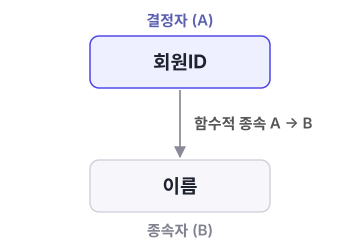
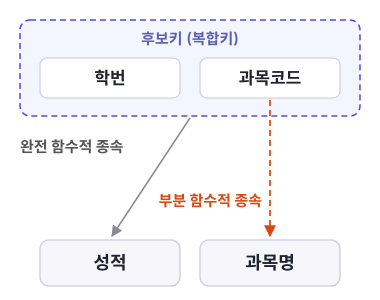

[3편](/blog/db-normalization-3-1nf/)에서는 값의 형태를 원자값으로 맞추는 **1NF**를 다뤘습니다. 1NF는 "한 칸에 하나의 값"이라는 형태의 문제만 다룰 뿐, 속성들 사이의 관계는 건드리지 않습니다. 이번 편의 **제2정규형(2NF)** 부터는 속성 사이의 **함수적 종속성**을 정리합니다. 2NF가 다루는 것은 복합키의 일부에만 의존하는 속성입니다.

> **시리즈 구성**
> 1. [데이터 무결성과 키](/blog/db-normalization-1-integrity-and-keys/)
> 2. [이상현상과 함수적 종속성](/blog/db-normalization-2-anomalies/)
> 3. [제1정규형 (1NF)](/blog/db-normalization-3-1nf/)
> 4. **제2정규형 (2NF)** (이번 글)
> 5. [제3정규형 (3NF)](/blog/db-normalization-5-3nf/)
> 6. [보이스-코드 정규형 (BCNF)](/blog/db-normalization-6-bcnf/)
> 7. [자연키와 대리키: 키 설계](/blog/db-normalization-7-keys-natural-surrogate/)
> 8. [제4정규형과 제5정규형, 함수적 종속 너머의 중복](/blog/db-normalization-8-higher-normal-forms/)
> 9. [정규화 절차와 역정규화](/blog/db-normalization-9-procedure-and-denormalization/)

## 등장 배경

2NF는 E.F. Codd가 1971년 논문 「Further Normalization of the Data Base Relational Model」(IBM Research Report RJ909)에서 3NF와 함께 처음 정의한 정규형입니다. [3편](/blog/db-normalization-3-1nf/)에서 보았듯 1970년 관계형 모델 논문에는 정규형이 하나뿐이었습니다. 그 논문에서는 이 정규형을 "normal form"이라고만 불렀습니다. "first normal form"이라는 이름은 2NF, 3NF와 함께 1971년 논문에서 생겼습니다.

Codd가 이 논문에서 밝힌 정규화의 첫 번째 목적은 "바람직하지 않은 삽입, 갱신, 삭제 종속성을 제거하는 것"이었습니다([2편](/blog/db-normalization-2-anomalies/)에서 인용). 2NF는 그 목적을 향한 첫 단계로, 복합키에서 생기는 한 종류의 종속성을 정리합니다.

| 연도 | 정규형 | 도입 | 다루는 종속성 |
|------|--------|------|----------------|
| 1970 | 1NF | Codd | 원자값 (값의 형태) |
| 1971 | **2NF** | Codd | 부분 함수적 종속 |

> **여담: 'normalization'이라는 이름의 유래**
>
> 널리 회자되는 이야기가 하나 있습니다. Codd가 'normalization(정규화)'이라는 용어를, 당시 미국이 추진하던 외교 "관계 정상화(normalization of relations)"에서 따왔다는 것입니다. 관계형 모델의 '관계(relation)'와 외교 '관계'를 겹친 말장난인 셈입니다. 다만 출처에 따라 상대국이 중국이라고도 소련이라고도 하고, 1차 자료로 확인되지는 않아 사실 여부는 분명하지 않습니다.

## 함수적 종속성 다시 보기

[2편](/blog/db-normalization-2-anomalies/)에서 함수적 종속성의 기본(결정자, 종속자, 규칙으로서의 성격, 자명, 비자명 종속)을 다뤘습니다. 짧게 복습하면, **함수적 종속성** `A → B`는 결정자 A의 값이 정해지면 종속자 B의 값도 항상 하나로 정해지는 업무 규칙입니다. 예를 들어 `회원ID → 이름`이 그렇습니다.



2NF를 이해하려면 여기에 한 가지 구분을 더해야 합니다. 같은 함수적 종속이라도, 후보키가 **두 개 이상의 속성으로 이루어진 복합키**일 때 종속의 모습이 둘로 갈립니다. **완전 함수적 종속**과 **부분 함수적 종속**입니다.

### 완전 함수적 종속 (full functional dependency)

어떤 속성이 **복합키 전체**가 있어야 결정되는 경우입니다. 키를 이루는 속성을 하나라도 빼면 더 이상 값이 정해지지 않습니다.

예를 들어 수강신청을 `{학번, 과목코드}`로 식별할 때, `{학번, 과목코드} → 성적`은 완전 함수적 종속입니다. 성적은 "누가" 그리고 "어떤 과목을" 들었는지가 **둘 다** 있어야 정해지기 때문입니다.

### 부분 함수적 종속 (partial functional dependency)

어떤 속성이 복합키의 **일부**만으로 결정되는 경우입니다. 한국어로 풀면 "키의 일부에만 의존하는 종속"입니다.

같은 예에서 `과목코드 → 과목명`을 봅시다. 과목명은 `과목코드`만 알면 정해지고, `학번`은 필요하지 않습니다. 즉 `과목명`은 복합키 `{학번, 과목코드}`의 **일부**인 `과목코드`에만 종속됩니다. 이것이 부분 함수적 종속입니다.

> 참고: 후보키가 단일 속성이면 "일부"라는 것이 존재하지 않으므로 부분 함수적 종속이 성립할 수 없습니다. 그래서 부분 함수적 종속 문제는 복합 후보키에서만 나타납니다.



## 부분 함수적 종속의 문제: 삽입, 갱신, 삭제 이상

부분 함수적 종속이 남은 테이블에서는 [2편](/blog/db-normalization-2-anomalies/)의 이상현상 세 가지가 모두 생깁니다. 위 수강신청 테이블에 과목명까지 함께 둔 경우로 보겠습니다.

| 학번 | 과목코드 | 성적 | 과목명 |
|------|----------|------|--------|
| S1 | C1 | A | 데이터베이스 |
| S2 | C1 | B | 데이터베이스 |
| S1 | C2 | A | 운영체제 |

- **삽입 이상**: 새 과목 C3(컴퓨터구조)를 개설해도, 수강하는 학생이 없으면 이 테이블에 넣을 수 없습니다. `학번`이 기본키의 일부라서 비워 둘 수 없기 때문입니다.
- **갱신 이상**: 과목명을 `데이터베이스 개론`으로 바꾸려면 C1을 듣는 모든 행을 고쳐야 합니다. 한 행이라도 놓치면 같은 `과목코드`에 과목명이 두 개 존재합니다.
- **삭제 이상**: S1이 C2 수강을 취소해 그 행을 지우면, C2가 운영체제라는 사실도 함께 사라집니다. C2를 듣는 학생이 S1 하나뿐이었기 때문입니다.

세 이상현상의 원인은 하나입니다. "과목코드가 어떤 과목명인가"라는 과목의 사실이, "누가 무엇을 들었는가"라는 수강의 사실과 같은 행에 저장되어 있습니다. 2NF는 이 두 사실을 다른 테이블로 나누라고 요구합니다.

## 2NF의 정의

- **주요 속성(prime attribute)**: 어떤 후보키에든 포함되는 속성
- **비주요 속성(non-prime attribute)**: 어떤 후보키에도 포함되지 않는 속성

예를 들어 후보키가 `{학번, 과목코드}` 하나인 수강신청 테이블에서, `학번`과 `과목코드`는 후보키에 포함되므로 **주요 속성**입니다. `성적`과 `과목명`은 어느 후보키에도 포함되지 않으므로 **비주요 속성**입니다.

**제2정규형(Second Normal Form)은 1NF를 만족하고, 모든 비주요 속성이 각 후보키에 완전 함수적 종속이어야 한다**는 조건입니다. 바꿔 말하면 **비주요 속성의 부분 함수적 종속을 제거**하는 것이 2NF입니다. 키에 속하지 않는 속성은 키의 일부가 아니라 키 전체에 의존해야 합니다.

> Codd의 1971년 정의 자체는 위와 같은 의미이며, 이 글에서는 표준 교재의 서술을 따라 풀어 썼습니다. (3NF의 경우 다음 편에서 원문 정의를 그대로 인용합니다.)

이 정의에는 놓치기 쉬운 조건이 둘 있습니다. 판정 기준이 기본키 하나가 아니라는 점과, 주요 속성은 검사 대상이 아니라는 점입니다.

### 판정 기준: 기본키가 아니라 모든 후보키

정의의 "각 후보키"는 기본키로 고른 하나만을 뜻하지 않습니다. 테이블에 후보키가 여럿이면, 그중 어느 하나의 일부에라도 비주요 속성이 종속되면 2NF 위반입니다.

기본키를 단일 속성으로 골라도 이 조건은 그대로입니다. 다른 복합 후보키가 남아 있으면 그 키를 기준으로 부분 함수적 종속을 따져야 합니다. 대리키를 둔 테이블에서 이 경우가 생기며, 뒤의 [대리키 테이블의 판정](#대리키-테이블의-판정-숨은-복합-후보키)에서 예로 다룹니다.

### 예외: 주요 속성의 부분 함수적 종속

2NF가 검사하는 것은 **비주요 속성**뿐입니다. 주요 속성이 후보키의 일부에 종속되는 것은 2NF 위반이 아닙니다.

[6편](/blog/db-normalization-6-bcnf/)의 수강 테이블이 이 경우입니다. 후보키는 `{학생, 과목}`과 `{학생, 교수}` 둘이고, `교수 → 과목`이 성립합니다. `교수`는 후보키 `{학생, 교수}`의 일부이므로 `과목`은 키의 일부에 종속된 셈입니다. 그런데 `과목`은 후보키 `{학생, 과목}`에 포함되는 주요 속성입니다. 그래서 이 테이블은 2NF를 만족합니다. 이 테이블에 남는 중복은 BCNF가 다루며, 6편에서 그 과정을 설명합니다.

## 2NF로 만드는 과정

2NF로 정규화하려면 부분 함수적 종속을 찾아, 그 결정자와 종속 속성을 별도 테이블로 분리해야 합니다.

1. 후보키를 모두 찾는다. 후보키가 모두 단일 속성이면 부분 함수적 종속이 생길 수 없으므로 이미 2NF다.
2. 복합 후보키마다, 키에서 속성을 하나 이상 뺀 부분집합이 어떤 비주요 속성을 결정하는지 확인한다.
3. 부분 함수적 종속이 있으면, 그 결정자(키의 일부)와 거기에 종속되는 속성을 별도 테이블로 분리한다.
4. 분리한 테이블의 키를 원래 테이블에 외래키로 남겨 둘을 연결한다.

### 판정 절차: 키의 부분집합이 결정하는 속성

2단계는 **속성 폐포(attribute closure)** 로 확인합니다. 속성 집합 X의 폐포 X⁺는 X에서 출발해, 주어진 함수적 종속을 반복 적용해 결정되는 속성을 모두 모은 집합입니다.

수강신청 테이블의 종속은 `{학번, 과목코드} → 성적`과 `과목코드 → 과목명` 둘입니다. 후보키 `{학번, 과목코드}`의 진부분집합(자기 자신을 뺀 부분집합)은 `{학번}`과 `{과목코드}`입니다.

| 부분집합 | 폐포 | 폐포에 든 비주요 속성 | 판정 |
|----------|------|------------------------|------|
| `{학번}` | `{학번}` | 없음 | 부분 함수적 종속 없음 |
| `{과목코드}` | `{과목코드, 과목명}` | `과목명` | `과목명`이 부분 함수적 종속 |

폐포를 쓰는 이유는 종속이 여러 단계로 이어질 때도 빠짐없이 찾기 위해서입니다. 예를 들어 `과목코드 → 학과코드`이고 `학과코드 → 학과명`이면, `{과목코드}⁺`에 `학과명`까지 들어갑니다. 둘 다 키의 일부에 종속되므로 함께 분리 대상입니다.

### 분해 예시 1: 수강신청 테이블

판정 결과에 따라 `과목코드`에만 종속되는 `과목명`을, `과목코드`가 키인 테이블로 옮깁니다.

**수강신청**: `{학번, 과목코드}(PK)`, `성적`

| 학번 | 과목코드 | 성적 |
|------|----------|------|
| S1 | C1 | A |
| S2 | C1 | B |
| S1 | C2 | A |

**과목**: `과목코드(PK)`, `과목명`

| 과목코드 | 과목명 |
|----------|--------|
| C1 | 데이터베이스 |
| C2 | 운영체제 |
| C3 | 컴퓨터구조 |

세 이상현상이 모두 해소됩니다. 수강생이 없는 C3도 과목 테이블에 넣을 수 있습니다. 과목명을 바꿀 때는 과목 테이블의 한 행만 고치면 됩니다. S1이 C2 수강을 취소해도 C2가 운영체제라는 사실은 과목 테이블에 남습니다.

### 분해 예시 2: 주문상세 테이블

부분 함수적 종속이 키의 서로 다른 부분에 걸쳐 있으면 테이블이 셋으로 나뉩니다. 주문 한 건에 상품 여러 개를 담는 주문상세 테이블로 보겠습니다. 키는 `{주문번호, 상품코드}`입니다.

| 주문번호 | 상품코드 | 수량 | 주문일자 | 상품명 | 단가 |
|----------|----------|------|----------|--------|------|
| O1 | P1 | 2 | 2026-06-01 | 키보드 | 30000 |
| O1 | P2 | 1 | 2026-06-01 | 마우스 | 15000 |
| O2 | P1 | 1 | 2026-06-03 | 키보드 | 30000 |

- `{주문번호, 상품코드} → 수량`: 완전 함수적 종속
- `주문번호 → 주문일자`: 키의 일부인 `주문번호`에 종속
- `상품코드 → 상품명, 단가`: 키의 일부인 `상품코드`에 종속

`{주문번호}⁺`에는 `주문일자`가, `{상품코드}⁺`에는 `상품명`과 `단가`가 들어갑니다. 결정자가 둘이므로 각각 분리합니다.

- **주문**: `주문번호(PK)`, `주문일자`
- **상품**: `상품코드(PK)`, `상품명`, `단가`
- **주문상세**: `{주문번호, 상품코드}(PK)`, `수량`. `주문번호`는 주문을, `상품코드`는 상품을 참조하는 외래키

여기서 `단가`의 종속은 업무 규칙에 따라 달라집니다. 위 분해는 "단가는 상품의 현재 가격"이라는 규칙을 전제로 합니다. 규칙이 "주문 시점의 가격을 남긴다"라면, 그 가격은 주문과 상품이 모두 정해져야 결정됩니다. 즉 `{주문번호, 상품코드}`에 완전 함수적 종속이므로 주문상세에 남습니다. 함수적 종속은 데이터가 아니라 업무 규칙에서 정해진다는 [2편](/blog/db-normalization-2-anomalies/)의 내용이 여기서도 적용됩니다.

### 분해가 무손실인 조건

나눈 테이블을 다시 조인했을 때 원래 데이터가 그대로 나와야 분해가 의미를 가집니다([2편](/blog/db-normalization-2-anomalies/)에서 다룬 무손실 조인). Silberschatz 등의 교재 *Database System Concepts*는 무손실을 보장하는 조건을 이렇게 정리합니다. 테이블 R을 R1과 R2로 나눌 때, 두 테이블의 공통 속성(R1 ∩ R2)이 R1이나 R2 중 한쪽의 슈퍼키이면 무손실 분해입니다. 기호로는 `R1 ∩ R2 → R1` 또는 `R1 ∩ R2 → R2`입니다.

예시 1에서 공통 속성은 `과목코드`이고, `과목코드`는 과목 테이블의 키입니다. 그래서 수강신청과 과목을 `과목코드`로 조인하면 원래의 세 행이 그대로 나옵니다. 예시 2도 같습니다. 주문을 떼어 낼 때의 공통 속성 `주문번호`는 주문의 키이고, 상품을 떼어 낼 때의 공통 속성 `상품코드`는 상품의 키입니다.

조건을 어기면 무손실이 보장되지 않습니다. 이 예에서는 조인 결과에 원래 없던 행이 생깁니다. 수강신청 테이블을 `(학번, 과목코드, 성적)`과 `(학번, 과목명)`으로 잘못 나눈 경우를 보겠습니다. 공통 속성 `학번`은 과목명을 결정하지 못합니다. 두 테이블을 `학번`으로 조인하면 원래 3행이 5행이 됩니다.

| 학번 | 과목코드 | 성적 | 과목명 | |
|------|----------|------|--------|---|
| S1 | C1 | A | 데이터베이스 | |
| S1 | C1 | A | 운영체제 | 원래 없던 행 |
| S2 | C1 | B | 데이터베이스 | |
| S1 | C2 | A | 데이터베이스 | 원래 없던 행 |
| S1 | C2 | A | 운영체제 | |

S1이 들은 두 과목의 이름이 S1의 모든 수강 행에 붙었습니다. 이렇게 늘어난 결과에서는 어느 행이 원래 데이터인지 가려낼 수 없습니다.

### 분해 결과의 SQL 정의

예시 1의 분해를 테이블 정의로 옮기면 아래와 같습니다. 2NF가 요구하는 분리는 기본키로, 두 테이블의 연결은 외래키로 표현됩니다.

```sql
CREATE TABLE 과목 (
  과목코드 VARCHAR(10) PRIMARY KEY,
  과목명   VARCHAR(100) NOT NULL
);

CREATE TABLE 수강신청 (
  학번     VARCHAR(10),
  과목코드 VARCHAR(10),
  성적     CHAR(2),
  PRIMARY KEY (학번, 과목코드),
  FOREIGN KEY (과목코드) REFERENCES 과목 (과목코드)
);
```

과목명이 과목 테이블에만 있으므로, 한 과목코드에 과목명이 둘인 상태는 저장할 방법이 없습니다. 외래키는 과목 테이블에 없는 과목코드로 수강신청을 넣는 것을 막습니다. 다만 DBMS가 외래키를 검사할 때만 그렇습니다. SQLite는 `PRAGMA foreign_keys = ON`을 켜야 검사하고, MySQL의 MyISAM 엔진은 검사하지 않습니다.

### 데이터로 위반 찾기

분해 전 테이블(아래에서는 `수강신청_원본`)에서 `과목코드 → 과목명`이 데이터상 깨져 있는지는 쿼리로 찾을 수 있습니다. 과목코드별로 서로 다른 과목명의 개수를 세어 둘 이상인 것을 고릅니다.

```sql
SELECT 과목코드, COUNT(DISTINCT 과목명) AS 과목명_수
FROM 수강신청_원본
GROUP BY 과목코드
HAVING COUNT(DISTINCT 과목명) > 1;
```

결과가 나오면 그 과목코드에서 종속이 깨진 것입니다. 갱신 이상이 이미 일어났거나, `과목코드 → 과목명`이 애초에 업무 규칙이 아니었다는 뜻입니다.

`COUNT(DISTINCT 과목명)`은 NULL을 세지 않습니다. 그래서 한 과목코드에 '데이터베이스'와 NULL이 섞여 있는 경우는 이 쿼리에 나오지 않습니다.

이 쿼리로는 반대 방향을 증명할 수 없습니다. 결과가 비어 있어도 "지금 저장된 행이 종속에 어긋나지 않는다"는 것만 알 수 있습니다. 함수적 종속은 앞으로 들어올 행까지 포함하는 업무 규칙이므로, 종속이 성립하는지는 업무 규칙을 확인해 정해야 합니다. 데이터는 종속이 깨졌다는 것만 보여 줄 수 있습니다.

## 대리키 테이블의 판정: 숨은 복합 후보키

부분 함수적 종속은 복합 후보키에서만 생깁니다. 따라서 **1NF를 만족하면서 후보키가 모두 단일 속성인 테이블은 2NF를 만족합니다**. 예를 들어 `회원ID` 하나만 후보키인 회원 테이블에서는, 다른 속성이 키의 "일부"에 종속될 여지가 없습니다.

기본키가 단일 속성이라는 것만으로는 이 조건을 판단할 수 없습니다. 수강신청 테이블에 대리키 `id`를 기본키로 둔 경우를 보겠습니다. 한 학생이 한 과목을 한 번만 신청한다는 규칙은 UNIQUE 제약으로 겁니다. [7편](/blog/db-normalization-7-keys-natural-surrogate/)에서 다룬 "대리키를 기본키로, 자연키에 UNIQUE" 구성입니다.

```sql
CREATE TABLE 수강신청 (
  id       BIGINT PRIMARY KEY,
  학번     VARCHAR(10) NOT NULL,
  과목코드 VARCHAR(10) NOT NULL,
  성적     CHAR(2),
  과목명   VARCHAR(100),
  UNIQUE (학번, 과목코드)
);
```

이 테이블의 후보키는 `{id}`와 `{학번, 과목코드}` 둘입니다. `과목명`은 후보키 `{학번, 과목코드}`의 일부인 `과목코드`에 종속되므로 2NF 위반입니다. 기본키를 `id`로 바꿨어도 앞에서 본 세 이상현상은 그대로 남습니다.

후보키를 정하는 것은 UNIQUE 제약이 아니라 업무 규칙입니다. UNIQUE 제약은 그 규칙을 데이터베이스에 선언한 것입니다. 제약을 걸지 않았어도 업무상 `{학번, 과목코드}`가 한 행만 식별한다면 후보키입니다.

반대로 재수강을 허용해 같은 학생이 같은 과목을 여러 번 신청할 수 있다면, `{학번, 과목코드}`는 후보키가 아닙니다. 다른 복합 후보키도 없다면 후보키는 `{id}` 하나이고 테이블은 2NF를 만족합니다. 그래도 과목명의 중복은 남습니다. 이 중복은 `id → 과목코드 → 과목명`으로 이어지는 종속에서 생기며, 다음 편의 3NF가 다룹니다.

## 연습 문제

각 테이블이 2NF를 만족하는지 판정하고, 만족하지 않으면 2NF로 분해해 보세요. 테이블은 모두 1NF를 만족한다고 가정합니다.

**문제 1**: 대여(`회원ID`, `도서ID`, `대여일`, `반납일`, `회원명`, `도서명`)

- 후보키: `{회원ID, 도서ID, 대여일}`
- 종속: `{회원ID, 도서ID, 대여일} → 반납일`, `회원ID → 회원명`, `도서ID → 도서명`

<details>
<summary>답 보기</summary>

2NF 위반입니다. `{회원ID}⁺`에 `회원명`이, `{도서ID}⁺`에 `도서명`이 들어갑니다. 둘 다 후보키의 일부에 종속된 비주요 속성입니다.

- 회원: `회원ID(PK)`, `회원명`
- 도서: `도서ID(PK)`, `도서명`
- 대여: `{회원ID, 도서ID, 대여일}(PK)`, `반납일`

</details>

**문제 2**: R(`A`, `B`, `C`, `D`)

- 후보키: `{A, B}`
- 종속: `{A, B} → C`, `C → D`

<details>
<summary>답 보기</summary>

2NF를 만족합니다. 진부분집합의 폐포는 `{A}⁺ = {A}`, `{B}⁺ = {B}`로, 비주요 속성을 하나도 결정하지 않습니다. `D`는 키의 일부가 아니라 비주요 속성 `C`를 거쳐 종속됩니다. 이는 이행적 함수적 종속이고, 3NF에서 다룰 대상입니다.

</details>

**문제 3**: 좌석예약(`예약ID`, `공연ID`, `좌석번호`, `예약자`, `공연명`)

- 기본키: `예약ID`
- 업무 규칙: 한 공연의 한 좌석은 한 번만 예약된다(`UNIQUE (공연ID, 좌석번호)`)
- 종속: `공연ID → 공연명`

<details>
<summary>답 보기</summary>

2NF 위반입니다. 후보키는 `{예약ID}`와 `{공연ID, 좌석번호}` 둘입니다. `공연명`은 후보키 `{공연ID, 좌석번호}`의 일부인 `공연ID`에 종속됩니다. 기본키가 단일 속성이어도 다른 복합 후보키를 기준으로 판정합니다.

- 공연: `공연ID(PK)`, `공연명`
- 좌석예약: `예약ID(PK)`, `공연ID`, `좌석번호`, `예약자`. `UNIQUE (공연ID, 좌석번호)`, `공연ID`는 공연을 참조하는 외래키

</details>

## 2NF가 아직 남기는 것

부분 함수적 종속을 제거해도 중복이 완전히 사라지는 것은 아닙니다. 2NF는 "키의 일부에 종속되는" 문제만 다룰 뿐, **키가 아닌 다른 속성을 거쳐 종속되는** 경우는 여전히 남습니다. 연습 문제 2의 `C → D`와 대리키 테이블의 `id → 과목코드 → 과목명`이 그 예입니다.

예를 들어 직원 테이블에서 `직원ID → 부서ID`이고 `부서ID → 부서명`이라면, `부서명`은 키(`직원ID`)에 직접 종속되는 것이 아니라 `부서ID`를 거쳐 종속됩니다. 이 테이블의 키가 단일키 `직원ID`라면 부분 함수적 종속이 없으므로 2NF는 만족하지만, 부서 정보는 여전히 직원마다 중복됩니다.

이처럼 다른 속성을 거쳐 종속되는 관계를 **이행적 함수적 종속(transitive functional dependency)** 이라 하며, 이를 제거하는 것이 다음 편에서 다룰 3NF입니다.

## 정리

- **함수적 종속성** `A → B`는 A가 정해지면 B가 항상 하나로 정해지는 업무 규칙이다 (A는 결정자, B는 종속자)
- **완전 함수적 종속**은 복합키 전체가 있어야 결정되는 경우, **부분 함수적 종속**은 키의 일부만으로 결정되는 경우다
- 부분 함수적 종속이 남으면 삽입, 갱신, 삭제 이상이 모두 생긴다
- **2NF**는 1NF를 만족하면서 모든 비주요 속성이 **각 후보키**에 완전 함수적 종속되어야 한다. 기본키 하나가 아니라 모든 후보키가 기준이고, 주요 속성의 부분 함수적 종속은 위반이 아니다
- 판정은 복합 후보키의 진부분집합마다 **속성 폐포**를 구해, 비주요 속성이 들어가는지 본다
- 공통 속성이 한쪽 테이블의 키가 되도록 나누면 **무손실**이 보장된다
- 데이터를 조회해서는 종속이 깨졌다는 것만 확인할 수 있고, 종속이 성립하는지는 업무 규칙으로 정한다
- 기본키가 대리키여도 복합 후보키가 남아 있으면 2NF 위반이 생길 수 있다
- 2NF는 부분 함수적 종속만 다루며, 다른 속성을 거치는 **이행적 함수적 종속**은 3NF에서 해결한다

다음 편에서는 **[제3정규형(3NF)](/blog/db-normalization-5-3nf/)** 을 다루며, 이행적 함수적 종속을 제거하는 방법을 살펴보겠습니다.

## 참고 문헌

- E.F. Codd, *Further Normalization of the Data Base Relational Model*, IBM Research Report RJ909, 1971. (2NF, 3NF의 원전. 정식 출판은 Prentice-Hall, 1972)
- R. Elmasri, S.B. Navathe, *Fundamentals of Database Systems*. (완전, 부분 함수적 종속과 2NF의 표준 서술)
- A. Silberschatz, H.F. Korth, S. Sudarshan, *Database System Concepts*. (속성 폐포와 무손실 분해 조건)
