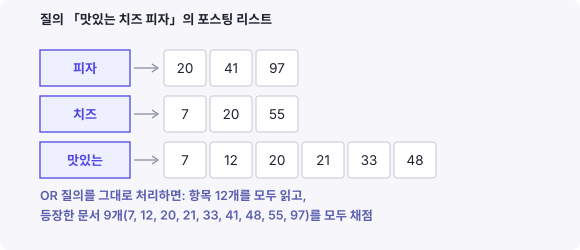
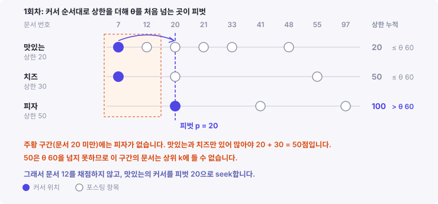
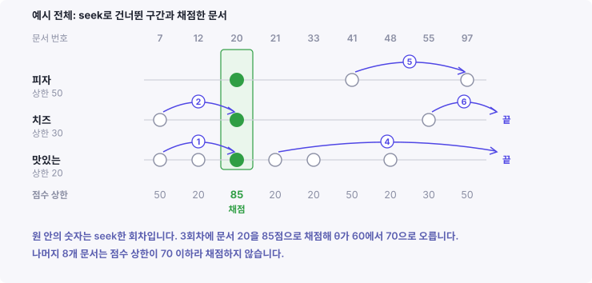

[입금자명 BM25 글](/blog/bm25-vs-difflib-name-matching/)에서 BM25는 입금 한 건에 0.45ms로 difflib보다 약 48배 빨랐습니다. BM25가 빨랐던 이유는 역색인입니다. 역색인은 토큰마다 그 토큰이 든 거래처 목록을 미리 만들어 둔 것입니다. BM25는 입금자명 토큰의 목록만 읽고 점수를 계산합니다.

다만 목록의 길이는 토큰마다 다릅니다. 흔한 토큰일수록 목록이 깁니다. 그 글의 데이터에서는 법인 하나의 거래처가 많아야 1,587곳이었습니다. 그래서 가장 긴 목록도 1,587개를 넘지 않았습니다. 문서가 수백만 건인 색인에서는 흔한 토큰 하나의 목록이 수백만 개가 됩니다. 그 글에서 다루지 않은 비용은 이 긴 목록을 읽는 비용입니다.

긴 목록의 문서를 모두 채점하지 않고도 점수가 높은 문서를 찾을 수 있습니다. WAND는 Broder 등이 2003년 CIKM[^cikm]에서 발표한 알고리즘입니다. 결과에 들 수 없는 문서는 채점하지 않고 건너뜁니다. 건너뛰어도 결과는 모든 문서를 채점한 결과와 같습니다.

## WAND의 등장 배경: 채점할 후보가 너무 많다

앞선 BM25 글에서는 입금자명과 거래처 사이의 점수를 계산했습니다. 그 점수로 1위 거래처를 정했고, 1위와 2위의 점수 차가 크면 그 거래처로 확정했습니다. 역색인은 토큰마다 그 토큰이 든 문서 목록을 미리 만들어 둔 색인입니다. BM25 글에서는 거래처가 문서였습니다. 점수를 계산하는 방법은 정해졌습니다. 남은 문제는 수많은 문서 중 점수가 높은 문서를 찾는 일입니다.

검색어 `맛있는 치즈 피자`로 문서를 찾는다고 하겠습니다. **정보 검색에서는 질의를 이루는 토큰 하나하나를 항(term)이라고 부릅니다**. 이 질의의 항은 `맛있는`, `치즈`, `피자` 셋입니다.

BM25는 문서의 점수를 항별 점수의 합으로 계산합니다. 문서 $$d$$의 점수는 질의 $$q$$의 항 중 $$d$$에 든 항의 점수를 더한 값입니다.

$$
s(d) = \sum_{t \in q \cap d} w(t, d)
$$

$$w(t, d)$$는 항 $$t$$가 문서 $$d$$에서 받는 점수입니다. BM25에서는 IDF[^idf]와 빈도, 길이 보정으로 정해집니다.

질의의 항 중 하나라도 들어 있는 문서는 모두 후보입니다. 이런 질의를 OR 질의라고 합니다. 역색인에서 항 하나의 문서 목록을 **포스팅 리스트**(posting list)라고 부릅니다. OR 질의의 결과를 그대로 구하려면 세 항의 포스팅 리스트를 끝까지 읽고, 등장한 문서를 모두 채점해야 합니다. 비용은 세 포스팅 리스트의 길이를 더한 만큼입니다.



그런데 검색 결과는 정해진 개수만 보여 줍니다. 예를 들어 한 페이지에 점수 순으로 10개가 보입니다. 이 개수를 k라고 하겠습니다. BM25 글에서는 1위와 2위의 점수만 썼으므로 k가 2였습니다. 상위 k개만 맞으면 나머지 문서의 순위는 결과에 영향을 주지 않습니다. 나머지 문서는 정확한 점수를 몰라도 됩니다. 상위 k에 들지 못한다는 사실만 알면 됩니다.

모든 후보를 채점하면 순위 밖으로 밀려날 문서까지 채점하게 됩니다. WAND는 이 낭비를 줄입니다. 채점하기 전에 그 문서가 상위 k에 들 수 있는지부터 따지고, 들 수 없으면 채점하지 않습니다.

## WAND의 준비물: 포스팅 리스트, 항별 상한, 임계값

WAND에는 세 가지가 필요합니다.

**포스팅 리스트**: 항마다 그 항이 든 문서의 번호와 빈도를 문서 번호 오름차순으로 담은 목록입니다. 항 $$t$$의 포스팅 리스트를 $$L_t$$라고 적습니다. WAND는 포스팅 리스트마다 커서를 하나씩 둡니다. 커서는 그 목록에서 지금 보고 있는 위치입니다. 커서는 두 가지로 움직입니다. 한 칸 앞으로 가거나, 주어진 번호 이상인 첫 항목으로 바로 갑니다. 뒤의 동작을 seek라고 부릅니다. 포스팅 리스트에 뒤쪽 항목의 위치를 미리 적어 둔 건너뛰기 포인터(skip pointer)를 두거나 이진 탐색을 쓰면, seek는 중간 항목을 하나씩 읽지 않고 목표 위치로 갑니다.

**항별 상한**: 항 $$t$$가 어느 문서에서든 받을 수 있는 가장 큰 점수입니다.

$$
UB_t = \max_{d} \, w(t, d)
$$

상한은 색인을 만들 때 포스팅 리스트를 한 번 훑어 미리 계산해 둡니다. $$k_1$$은 BM25에서 빈도가 점수에 주는 영향을 조절하는 매개변수입니다. BM25에서는 항의 점수가 $$(k_1 + 1) \times \text{IDF}(t)$$를 넘지 못합니다. BM25 식에서 빈도를 반영하는 분수가 $$k_1 + 1$$보다 작기 때문입니다. 그래서 흔한 항은 IDF가 작고 상한도 작습니다.

**임계값**: 지금까지 찾은 상위 k개 중 가장 낮은 점수입니다. $$\theta$$로 적습니다. 아직 k개를 채우지 못했으면 0입니다. 새 문서가 결과에 들려면 점수가 $$\theta$$보다 커야 합니다. 검색이 진행되면서 더 높은 점수의 문서가 결과에 들어오므로, $$\theta$$는 내려가지 않습니다.

## 상한과 임계값의 관계: 임계값이 오를수록 필요한 항이 는다

예시의 상한을 피자 50, 치즈 30, 맛있는 20으로 두겠습니다. 문서가 받을 수 있는 점수는 그 문서에 든 항의 상한 합을 넘지 못합니다. 그래서 $$\theta$$가 정해지면 상위 k에 들기 위해 문서에 있어야 할 항도 정해집니다.

| 임계값 | 탈락하는 문서 | 상위 k에 들 수 있는 문서 |
|---|---|---|
| 25 | 맛있는만 든 문서(최대 20) | 피자나 치즈가 든 문서 |
| 60 | 피자가 없는 문서(최대 30 + 20 = 50) | 피자가 든 문서 |
| 85 | 항이 둘 이하인 문서(최대 50 + 30 = 80) | 세 항이 모두 든 문서 |

$$\theta$$가 25일 때는 피자나 치즈 하나만 있어도 결과에 들 수 있습니다. OR 질의에 가깝습니다. $$\theta$$가 85가 되면 세 항이 모두 있어야 합니다. AND 질의와 같아집니다. WAND라는 이름은 이 성질에서 왔습니다. Broder 등은 이 연산을 Weak AND 또는 Weighted AND라고 불렀습니다.

$$\theta$$가 오를수록 필요한 항이 늘고, 조건을 채우지 못하는 문서가 늘어납니다. WAND는 이런 문서를 채점하지 않고 건너뜁니다. 검색 초반에는 $$\theta$$가 낮아 건너뛰는 문서가 적고, 결과가 채워질수록 많이 건너뜁니다.

## WAND의 전제: 문서 번호순으로 정렬된 포스팅 리스트

WAND의 절차는 포스팅 리스트가 문서 번호순이라는 전제에 기댑니다. 번호순이면 네 가지가 가능합니다.

첫째, 여러 포스팅 리스트를 한 번에 나란히 훑을 수 있습니다. 커서들을 번호가 작은 쪽부터 앞으로 보내면, 같은 문서의 항목이 같은 시점에 만납니다. 한 문서의 점수를 그 자리에서 다 계산하고 다음 문서로 넘어갈 수 있습니다. 이렇게 문서 단위로 채점을 끝내며 나아가는 방식을 document-at-a-time이라고 부릅니다.

둘째, 목록을 읽지 않고도 어떤 문서에 그 항이 없다는 것을 알 수 있습니다. 피자의 포스팅 리스트에 5 다음 18이 있으면 문서 6부터 17까지는 피자가 없습니다. WAND의 건너뛰기는 이 성질을 씁니다.

셋째, 번호 사이의 간격으로 압축할 수 있습니다. 5, 18, 40, 97은 5, 13, 22, 57로 저장합니다. 간격은 원래 번호보다 작아 적은 비트로 저장됩니다.

넷째, seek가 가능합니다. 번호가 정렬돼 있어야 건너뛰기 포인터나 이진 탐색으로 목표 번호를 찾을 수 있습니다.

검색 라이브러리 Lucene도 포스팅 리스트를 번호순으로 읽습니다. Lucene의 `DocIdSetIterator` 문서는 이 반복자가 내려가지 않는 순서의 문서 번호를 돈다고 정의하고, `advance(target)`이 target 이상인 첫 문서로 이동한다고 설명합니다. `advance`가 WAND의 seek에 해당합니다.

포스팅 리스트를 점수 기여가 큰 순서로 정렬하는 방식도 있습니다. 이 정렬을 impact order라고 부릅니다. 점수가 큰 항목부터 읽으니 일찍 멈추기 쉽습니다. 대신 목록마다 순서가 달라 같은 문서의 항목이 같은 시점에 만나지 않습니다. 그래서 WAND는 이 정렬에서 쓸 수 없습니다.

## WAND의 절차: 피벗을 찾아 건너뛰거나 채점한다

WAND는 아래 다섯 단계를 반복합니다.

1. 항을 커서가 가리키는 문서 번호의 오름차순으로 정렬합니다.
2. 정렬한 순서대로 상한을 누적합니다. $$i$$번째까지의 누적을 $$S_i$$라고 적습니다.
3. $$S_i > \theta$$가 되는 가장 작은 $$i$$를 찾습니다. 이 항을 피벗 항이라 하고, 그 커서가 가리키는 문서 번호를 피벗 $$p$$라고 합니다. 그런 $$i$$가 없으면 검색을 끝냅니다.
4. 첫 번째 커서가 이미 $$p$$에 있으면 피벗 항까지의 커서가 모두 $$p$$에 있다는 뜻입니다. 문서 $$p$$를 채점해 결과에 넣고 $$\theta$$를 갱신합니다. 그 뒤 $$p$$에 있는 커서를 모두 한 칸 앞으로 보냅니다.
5. 그렇지 않으면 피벗 항 앞의 커서 중 $$p$$보다 뒤처진 커서 하나를 $$p$$로 seek합니다. 어느 커서를 고를지는 구현이 정합니다. 아래 코드와 예시는 포스팅 리스트가 가장 긴 항을 고릅니다.

피벗 $$p$$는 채점할 문서이면서 건너뛸 구간의 경계입니다. $$p$$보다 작은 번호의 문서는 피벗 항 앞의 항만 가질 수 있습니다. 그 항들의 상한을 다 더해도 $$\theta$$를 넘지 못하므로, 이 문서들은 상위 k에 들 수 없습니다. 5단계는 이 구간을 건너뜁니다.

seek한 커서는 $$p$$를 지나칠 수 있습니다. 그 항의 목록에 $$p$$가 없으면 $$p$$보다 큰 첫 항목에 섭니다. 그러면 커서의 순서가 바뀌므로, 매 회차 1단계에서 다시 정렬합니다.

Python으로 적으면 아래와 같습니다. 커서의 `doc`은 현재 문서 번호, `next()`는 한 칸 이동, `seek(p)`는 $$p$$ 이상인 첫 항목으로의 이동입니다. `push_topk`는 결과 목록(힙)[^heap]에 문서를 넣고, 결과가 k개 미만이면 0을, 아니면 k개 중 최저 점수를 돌려줍니다.

```python
def wand(cursors, UB, k):
    heap, theta = [], 0.0
    while True:
        live = [t for t in cursors if not cursors[t].done()]
        order = sorted(live, key=lambda t: cursors[t].doc)       # 1
        acc, pivot_i = 0.0, None
        for i, t in enumerate(order):                             # 2, 3
            acc += UB[t]
            if acc > theta:
                pivot_i = i
                break
        if pivot_i is None:
            return heap                                           # 종료
        p = cursors[order[pivot_i]].doc
        if cursors[order[0]].doc == p:                            # 4
            here = [t for t in order if cursors[t].doc == p]
            score = sum(cursors[t].weight() for t in here)
            theta = push_topk(heap, p, score, k)
            for t in here:
                cursors[t].next()
        else:                                                     # 5
            behind = [t for t in order[:pivot_i] if cursors[t].doc < p]
            t = max(behind, key=lambda t: cursors[t].length)
            cursors[t].seek(p)
```

피벗 항 앞의 커서가 이미 $$p$$에 있을 수 있으므로 5단계는 `behind`를 따로 고릅니다. 이미 $$p$$에 있는 커서를 고르면 seek해도 움직이지 않아 같은 회차가 끝없이 반복됩니다.

## 절차 적용 예시: 맛있는 치즈 피자

앞의 상한을 그대로 씁니다. 피자 50, 치즈 30, 맛있는 20입니다. 상위 2개를 찾는 검색이고, 문서 6까지는 이미 처리했습니다. 그때까지 찾은 상위 2개의 점수가 60과 70이라 $$\theta$$는 60입니다. 문서 7부터 남은 포스팅 리스트는 아래와 같습니다.

| 항 | 상한 | 남은 포스팅 리스트 |
|---|---|---|
| 피자 | 50 | 20, 41, 97 |
| 치즈 | 30 | 7, 20, 55 |
| 맛있는 | 20 | 7, 12, 20, 21, 33, 48 |

`맛있는`은 흔한 항이라 목록이 가장 길고 상한이 가장 작습니다. 문서 20에서 세 항의 점수는 피자 45, 치즈 25, 맛있는 15라고 하겠습니다. 커서 번호가 같으면 목록이 긴 항을 앞에 놓습니다. WAND를 실행하면 일곱 회차에 끝납니다.

| 회차 | 커서 위치 | 상한 누적 | 피벗 | 동작 |
|---|---|---|---|---|
| 1 | 맛있는 7, 치즈 7, 피자 20 | 20, 50, 100 | 피자의 20 | 맛있는을 20으로 seek. 문서 12를 건너뜀 |
| 2 | 치즈 7, 맛있는 20, 피자 20 | 30, 50, 100 | 피자의 20 | 치즈를 20으로 seek. 문서 7을 건너뜀 |
| 3 | 세 커서 모두 20 | 20, 70, 100 | 20 | 문서 20을 85점으로 채점. 임계값 60에서 70으로 |
| 4 | 맛있는 21, 피자 41, 치즈 55 | 20, 70, 100 | 치즈의 55 | 맛있는을 55로 seek. 55 이상이 없어 목록 끝 |
| 5 | 피자 41, 치즈 55 | 50, 80 | 치즈의 55 | 피자를 55로 seek. 커서는 97에 섬 |
| 6 | 치즈 55, 피자 97 | 30, 80 | 피자의 97 | 치즈를 97로 seek. 97 이상이 없어 목록 끝 |
| 7 | 피자 97 | 50 | 없음 | 50이 70을 넘지 못해 종료 |

1회차에서 $$\theta$$는 60입니다. `맛있는`과 치즈의 상한을 더하면 50이라 60을 넘지 못합니다. 피자까지 더해야 100으로 60을 넘으므로 피벗은 피자의 20입니다. 문서 20보다 앞의 문서는 피자가 없어 많아야 50점입니다. 그래서 `맛있는`의 커서를 20으로 옮기고, 문서 12는 채점하지 않습니다.



2회차도 같은 이유로 치즈의 커서를 20으로 옮깁니다. 문서 7에는 치즈와 `맛있는`이 있지만, 두 상한을 더해도 50입니다.

3회차에는 세 커서가 모두 20에 있습니다. 첫 커서가 피벗에 있으므로 문서 20을 채점합니다. 점수는 45 + 25 + 15 = 85입니다. 결과는 60, 70에서 70, 85가 되고 $$\theta$$는 70으로 오릅니다.

4회차에서는 오른 $$\theta$$가 효과를 냅니다. `맛있는`과 피자의 상한을 더하면 70입니다. 70은 70을 넘지 못하므로 치즈까지 더해야 합니다. 피벗은 치즈의 55입니다. 55보다 앞의 문서는 `맛있는`과 피자만 가질 수 있으니 많아야 70점입니다. `맛있는`의 커서를 55로 옮기면 목록이 끝납니다. 문서 21, 33, 48은 채점하지 않습니다.

5회차에 피자의 커서를 55로 옮기면 55를 지나 97에 섭니다. 피자의 목록에 55가 없기 때문입니다.

6회차에는 커서 순서가 바뀌어 치즈가 앞에 옵니다. 문서 55에는 치즈만 남아 많아야 30점입니다. 피벗은 피자의 97이 되고, 치즈의 커서를 97로 옮기면 목록이 끝납니다.

7회차에는 피자만 남고 상한 50이 $$\theta$$ 70을 넘지 못해 검색을 끝냅니다.



남은 포스팅 리스트의 항목은 12개, 등장한 문서는 9개입니다. 그중 채점한 문서는 20 하나입니다. 채점하지 않은 문서 8개의 점수 상한은 모두 70 이하입니다.

| 채점하지 않은 문서 | 든 항 | 점수 상한 |
|---|---|---|
| 7 | 치즈, 맛있는 | 50 |
| 12, 21, 33, 48 | 맛있는 | 20 |
| 41, 97 | 피자 | 50 |
| 55 | 치즈 | 30 |

## WAND의 안전성: 건너뛴 문서는 상위 k에 들 수 없다

예시에서 건너뛴 문서는 모두 상위 2개에 들 수 없었습니다. 이 결과가 우연이 아님을 보이겠습니다.

어느 회차에서 항을 커서 순으로 $$t_{(1)}, \dots, t_{(m)}$$으로 정렬했고, 피벗 항이 $$t_{(i)}$$, 피벗이 $$p$$라고 하겠습니다. 피벗의 정의에 따라 $$i$$번째 바로 앞까지의 상한 누적은 $$\theta$$를 넘지 않습니다.

$$
S_{i-1} = \sum_{j < i} UB_{t_{(j)}} \le \theta
$$

$$t_{(i)}$$부터 $$t_{(m)}$$까지의 커서는 모두 $$p$$ 이상의 번호에 있습니다. 포스팅 리스트가 번호순이므로, 아직 처리하지 않은 문서 중 번호가 $$p$$보다 작은 문서 $$d$$에는 이 항들이 없습니다. 따라서 $$d$$에 든 항은 $$t_{(1)}$$부터 $$t_{(i-1)}$$ 중 일부이고, 점수는 다음 값을 넘지 못합니다.

$$
s(d) = \sum_{t \in q \cap d} w(t, d) \le \sum_{j < i} UB_{t_{(j)}} = S_{i-1} \le \theta
$$

$$d$$의 점수는 $$\theta$$를 넘지 못하므로 지금의 상위 k에 들 수 없습니다. $$\theta$$는 내려가지 않으므로 이후에도 들 수 없습니다. 점수가 $$\theta$$와 정확히 같은 문서는 결과에 있는 최저 점수 문서와 동점입니다. 빼도 상위 k개의 점수는 달라지지 않습니다.

이 증명이 쓰는 가정은 하나입니다. 모든 문서에서 $$UB_t \ge w(t, d)$$여야 합니다. 상한을 실제 최대 점수보다 작게 잡으면, 상위 k에 들어야 할 문서를 건너뛸 수 있습니다. 반대로 상한을 크게 잡는 것은 안전합니다. 다만 피벗이 앞당겨져 건너뛰는 문서가 줄어듭니다.

Broder 등은 임계값을 일부러 높여 더 많이 건너뛰는 설정도 다뤘습니다. 이 설정에서는 상위 k에 들 문서를 놓칠 수 있습니다. 위의 증명은 임계값을 실제 k번째 점수로 둘 때만 성립합니다.

## 흔한 토큰의 긴 목록은 비용이 얼마나 들까?

도입부에서 말한 긴 목록의 비용으로 돌아가겠습니다. 흔한 토큰의 포스팅 리스트는 길지만, WAND에서는 그 길이만큼 비용을 치르지 않습니다.

흔한 토큰은 IDF가 작고, 앞에서 본 것처럼 BM25 점수의 상한도 작습니다. 상한이 작으면 누적의 앞쪽에 와도 $$\theta$$를 넘기지 못합니다. 그래서 흔한 토큰은 피벗 항이 되기 어렵고, 피벗 항 앞에 남아 seek 대상이 됩니다. 5단계에서 목록이 긴 항을 고르면, 흔한 토큰의 커서가 가장 자주 seek합니다.

예시의 `맛있는`이 그랬습니다. 남은 항목 12개 중 6개가 `맛있는`이었습니다. 이 항의 커서는 두 번 seek했고, 문서 12, 21, 33, 48을 채점 없이 넘겼습니다. 피벗을 정한 것은 `맛있는`보다 드물어 상한이 큰 `피자`와 `치즈`였습니다.

피벗은 드문 토큰이 정하고, 흔한 토큰은 그 피벗 문서에 자기가 있는지만 확인합니다. 흔한 토큰의 목록이 길어도 채점하는 문서 수는 대체로 드문 토큰의 목록이 정합니다. 건너뛰기 포인터가 있으면 seek가 중간 항목을 읽지 않으므로, 읽는 항목 수도 줄어듭니다.

## WAND의 한계 1: 흔한 토큰만 있는 질의

흔한 토큰을 건너뛰는 효과는 질의에 상한이 큰 드문 토큰이 있을 때 나옵니다. 질의가 흔한 토큰으로만 이뤄지면 효과가 작습니다.

모든 항의 상한이 작고 비슷하면, $$\theta$$를 넘기려면 대부분의 항이 있어야 합니다. 그런데 흔한 토큰은 여러 문서에 함께 나오므로 조건을 채우는 문서가 많습니다. 피벗이 촘촘하게 잡히고, seek 한 번에 건너뛰는 구간이 짧습니다. 모든 포스팅 리스트가 길기 때문에 짧은 seek를 많이 반복하게 됩니다. 매 회차 커서를 정렬하는 비용도 있어, 모든 문서를 채점하는 방법보다 느려질 수도 있습니다.

색인 단계에서 이 비용을 줄이는 방법도 있습니다. 불용어[^stopword]를 색인에서 빼면 그 토큰의 포스팅 리스트 자체가 없어집니다. 다만 그 토큰이 점수에 주던 기여도 사라지므로, 결과가 모든 문서를 채점한 결과와 달라집니다. 결과를 보존하는 WAND와 달리 결과를 바꾸는 선택입니다.

## WAND의 한계 2: 한 문서 때문에 커진 상한

상한은 포스팅 리스트 전체에서의 최댓값입니다. 한 문서만 점수가 크고 나머지 문서가 작아도, 상한은 그 한 문서가 정합니다.

예를 들어 `맛있는`이 대부분의 문서에서 5점 안팎이고, 길이가 아주 짧은 문서 하나에서만 20점을 받는다고 하겠습니다. 상한은 20입니다. WAND는 나머지 문서에서도 `맛있는`이 20점을 줄 수 있다고 계산합니다. 누적 상한이 실제 점수보다 커지므로 $$\theta$$를 넘는 피벗이 앞당겨지고, 건너뛰는 구간이 짧아집니다. 결과는 여전히 정확하지만 건너뛰는 문서가 줄어듭니다.

## 상한을 쓰는 다른 알고리즘: MaxScore와 Block-Max WAND

MaxScore는 Turtle과 Flood가 1995년에 정리한 알고리즘입니다. WAND보다 먼저 나왔고, 같은 상한을 씁니다. 차이는 상한을 쓰는 방법입니다. MaxScore는 항을 상한 순으로 정렬하고, 상한이 작은 쪽부터 더해 합이 $$\theta$$ 이하인 항을 비필수 항으로 묶습니다. 비필수 항만 든 문서는 상위 k에 들 수 없습니다. 그래서 후보 문서는 필수 항의 포스팅 리스트에서만 고르고, 비필수 항은 그 후보에 있는지만 확인합니다. 필수와 비필수의 구분은 $$\theta$$가 오를 때마다 다시 합니다. WAND가 매 회차 커서 순서로 피벗을 정하는 데 비해, MaxScore는 상한 순서로 항을 나눕니다.

Block-Max WAND는 Ding과 Suel이 2011년 SIGIR[^sigir]에서 발표했습니다. 한계 2의 문제를 겨냥합니다. 포스팅 리스트를 일정 개수의 항목 묶음인 블록으로 나누고, 블록마다 그 안의 점수 상한을 저장합니다. WAND의 절차로 피벗을 찾은 뒤, 피벗 문서가 속한 블록들의 점수 상한을 다시 더해 봅니다. 그 합이 $$\theta$$를 넘지 못하면 피벗 문서를 채점하지 않고 블록 끝까지 건너뜁니다. 블록의 상한은 목록 전체의 상한보다 작거나 같으므로, 한 문서 때문에 커진 상한의 영향이 그 문서의 블록으로 좁혀집니다.

Elastic의 Adrien Grand는 2019년 Elastic 블로그 글에서 Block-Max WAND가 Lucene 8.0과, Lucene 기반 검색 엔진인 Elasticsearch 7.0에 들어간다고 밝혔습니다. 같은 글은 Lucene 벤치마크에서 OR 질의가 8% 느려진 경우부터 15배 빨라진 경우까지 있었다고 보고합니다. 대신 Elasticsearch는 전체 일치 건수를 기본 설정에서 정확히 세지 않도록 바뀌었습니다. 상위 k에 들 수 없는 문서를 건너뛰면 그 문서는 세지 않기 때문입니다.

## 마치며

WAND는 항마다 점수 상한을 두고, 상한의 합이 임계값을 넘지 못하는 구간을 건너뜁니다. 임계값은 검색이 진행될수록 오르고, 오를수록 건너뛰는 구간이 길어집니다. 건너뛴 문서는 상한의 정의 때문에 상위 k에 들 수 없으므로, 결과는 모든 문서를 채점한 결과와 같습니다.

BM25 글의 역색인은 목록이 가장 길어도 1,587개라 이 비용이 드러나지 않았습니다. 흔한 토큰의 목록이 수백만 개인 색인에서는, 흔한 토큰의 상한이 작다는 점 덕분에 WAND가 그 목록 대부분을 채점 없이 넘깁니다. 질의가 흔한 토큰으로만 이뤄지거나 상한이 한 문서 때문에 커지면 효과가 줄고, Block-Max WAND가 두 번째 경우를 블록 단위 상한으로 줄입니다.

## 부록: 점수 식의 집합 기호 읽는 법

점수 식의 시그마 아래 $$t \in q \cap d$$는 더할 항의 범위를 정합니다. 이 식은 질의와 문서를 항의 집합으로 봅니다.

- $$q$$는 질의에 든 항의 집합입니다. 예시 질의라면 {맛있는, 치즈, 피자}입니다.
- $$d$$는 문서에 든 항의 집합입니다.
- $$\cap$$는 교집합입니다. 두 집합에 모두 있는 항만 남깁니다.
- $$t \in q \cap d$$는 그 교집합에 든 항 $$t$$마다 $$w(t, d)$$를 더한다는 뜻입니다.

예시의 포스팅 리스트에 대입하면 이렇습니다. 문서 20에는 세 항이 모두 있으므로 세 항의 점수를 더합니다. 문서 7에는 치즈와 맛있는만 있으므로 두 항의 점수만 더합니다. 질의의 항이 하나도 없는 문서는 교집합이 비어 점수가 0이고, 후보에도 들지 않습니다.

## 참고 문헌

- A.Z. Broder, D. Carmel, M. Herscovici, A. Soffer, J. Zien, *Efficient Query Evaluation Using a Two-Level Retrieval Process*, Proc. CIKM 2003, pp. 426-434. [doi:10.1145/956863.956944](https://doi.org/10.1145/956863.956944) (WAND를 제안한 논문)
- S. Ding, T. Suel, *Faster Top-k Document Retrieval Using Block-Max Indexes*, Proc. SIGIR 2011, pp. 993-1002. [doi:10.1145/2009916.2010048](https://doi.org/10.1145/2009916.2010048) (Block-Max WAND를 제안한 논문)
- H. Turtle, J. Flood, *Query Evaluation: Strategies and Optimizations*, Information Processing & Management 31(6), 1995, pp. 831-850. [doi:10.1016/0306-4573(95)00020-H](https://doi.org/10.1016/0306-4573(95)00020-H) (MaxScore를 정리한 논문)
- [Elastic Blog: Faster retrieval of top hits in Elasticsearch with block-max WAND](https://www.elastic.co/blog/faster-retrieval-of-top-hits-in-elasticsearch-with-block-max-wand): Adrien Grand, 2019. Block-Max WAND가 Lucene 8.0과 Elasticsearch 7.0에 들어간다는 발표와 벤치마크.
- [Apache Lucene API: DocIdSetIterator](https://lucene.apache.org/core/9_0_0/core/org/apache/lucene/search/DocIdSetIterator.html): 문서 번호를 내려가지 않는 순서로 도는 반복자와 `advance(target)`의 정의.

[^cikm]: CIKM은 ACM International Conference on Information and Knowledge Management의 약자로, ACM이 여는 정보 및 지식 관리 분야 학회입니다.
[^idf]: IDF(inverse document frequency)는 토큰 하나가 얼마나 드문지를 나타내는 값입니다. 그 토큰이 든 문서가 적을수록 커지고, 거의 모든 문서에 들어 있으면 0에 가까워집니다. [BM25 글](/blog/bm25-vs-difflib-name-matching/)에서 설명했습니다.
[^heap]: 힙(heap)은 가장 작은 값을 맨 위에 두어 바로 꺼낼 수 있게 한 자료구조입니다. 결과 목록을 힙으로 두면 k개 중 최저 점수를 바로 확인하고 교체할 수 있습니다.
[^stopword]: 불용어(stop word)는 너무 흔해 문서를 구분하는 데 도움이 적은 단어입니다. 영어의 the, a 같은 단어가 대표적입니다.
[^sigir]: SIGIR는 ACM SIGIR Conference on Research and Development in Information Retrieval의 약자로, ACM의 정보 검색 분과가 여는 학회입니다.
